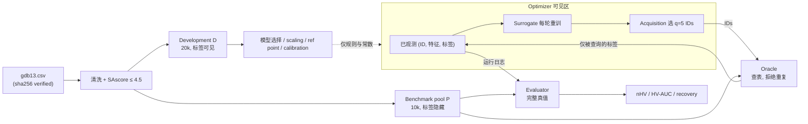

# Benchmark Spec v1.1

Finite-pool bi-objective active search on Tartarus organic emitters.
Machine-readable values live in [configs/benchmark.yaml](../configs/benchmark.yaml); this file gives the rules and reasons.
Any change after freezing bumps the version and is logged at the bottom.

## 1. 数据来源

Tartarus `datasets/gdb13.csv`，固定在 commit `5accbf7`，SHA-256 `c3d4dec0…b567b2`，398,453 行。
完整身份见 [data/raw/manifest.yaml](../data/raw/manifest.yaml)。所有处理前先校验 SHA-256，不一致则报错退出。

## 2. 目标

| 内部目标 | 原始列 | 单位 | 变换 |
|---|---|---|---|
| y1 | `singlet-triplet value` | eV | y1 = −ΔE_ST（带符号，不取绝对值） |
| y2 | `oscillator strength` | 无 | y2 = f_osc |

两者都最大化。ΔE_ST = min(S) − min(T)，负值视为更好，与 Tartarus 定义一致。
`multi-objective value` 和 `time (s)` 不使用。

## 3. 清洗与可行性约束

按顺序执行，每步记录剩余行数：

1. RDKit `MolFromSmiles`（含 sanitize）失败 → 删除；
2. canonical SMILES = `Chem.MolToSmiles(mol)`（RDKit 默认 isomeric + canonical）；
3. canonical SMILES 重复 → **整组删除**（不在冲突标签间做选择）；
4. y1 或 y2 非有限 → 删除；
5. SAscore 用 RDKit Contrib `SA_Score/sascorer.py` 计算，失败 → 删除；
6. SAscore > 4.5 → 删除。

SAscore 只由结构决定，用它过滤不构成标签泄漏。清洗后的集合记为 C。
`mol_id` = C 按 canonical SMILES 字典序排序后的行号（从 0 开始），与原始行序无关。

## 4. Development / Benchmark 隔离

使用 `numpy.random.default_rng`：

1. Benchmark pool P：`default_rng(42).choice(|C|, 10000, replace=False)`；
2. Development set D：从 C \ P 中 `default_rng(7).choice(·, 20000, replace=False)`。

P 与 D 在 canonical SMILES 上不相交，均以 `mol_id` 升序存储（下游抽样如 initial set 依赖此顺序）。C \ (P ∪ D) 不使用，仅 Week 9 额外 pool 可以使用。

- D：标签全部可见。只用于特征与模型选择、超参数、scaling、reference point 和 calibration。
- P：标签只能通过 Oracle 取得。正式 run 的 surrogate 每轮只在本 run 已观测的数据上从头拟合，不带入 D 上训练得到的权重。
- Week 9 额外 pool：从 C \ D 中用 seed 43、44 按同样方式抽取 10,000 个。

## 5. Seeds

| 用途 | 规则 |
|---|---|
| Pool | 42 |
| Development | 7 |
| Run seeds | r ∈ {0, …, 9}；至少完成 0–4 |
| Initial set | `default_rng(r).choice(P, 100, replace=False)`，所有方法共用（paired） |
| 方法内部随机性 | `default_rng(10000 + r)` 和 `torch.manual_seed(10000 + r)`：Random 选点、ParEGO 权重、MC sampler |

## 6. 预算

Initial 100 + 80 轮 × q=5 = 500 次 evaluations。一次评价一个分子计 1 次。
Oracle 规则：只接受 P 中的 `mol_id`；重复查询同一 ID 或查询 P 以外的 ID 直接报错；每次查询都写入日志。

## 7. 方法定义

特征：Morgan fingerprint 的 bit vector，radius=2，nBits=2048。
三种 model-based 方法共用同一个 surrogate（Week 3 冻结，见第 11 节），并使用第 8 节的 scaled targets。
每轮流程：用已观测数据重新拟合 → 对所有未查询候选预测 → 选 q 个。

- **Random**：从未查询候选中均匀、无放回地抽 q 个。
- **Greedy-HVI**：只使用 posterior mean μ(x)，逐个选 q 个点。每一步选使 HVI(μ(x) | 当前前沿) 最大的 x，其中当前前沿 = 已观测点 ∪ 本 batch 已选点的 μ。若所有候选的 HVI 都为 0，则选 μ1 + μ2 最大者；仍平局时选 `mol_id` 最小者。
- **ParEGO**：BoTorch `qLogNParEGO`，使用默认 augmented Chebyshev scalarization。逐个选 q 个点：每个位置从 simplex 上均匀重新抽一组权重，本 batch 已选点作为 `X_pending` 传入，然后在未查询候选上取 argmax（`optimize_acqf_discrete`）。
- **qLogEHVI**：BoTorch `qLogExpectedHypervolumeImprovement`，使用第 9 节的 reference point，partitioning 用 `FastNondominatedPartitioning(观测 Y)`，batch 用 `optimize_acqf_discrete` 的 sequential greedy 在未查询候选上选出。Oracle 是确定性的，所以不用 noisy 版本。

## 8. Objective scaling

z_j = (y_j − m_j) / s_j，其中 m_j 和 s_j 是 D 上 y_j 的均值和总体标准差（ddof=0）。

只用 D 拟合，所有 run 和所有方法共用。这是线性变换，不改变 Pareto dominance，只影响 HV 的相对权重。
Surrogate 内部可以另做 outcome standardization，但只能基于本 run 已观测的数据。

## 9. Reference point

r_j = D 上 z_j 的 5% 分位数（`numpy.quantile(z_j, 0.05)`，默认 linear 插值）。

- Acquisition 和 evaluation 共用同一个 r：固定、只依赖 D、不随 run 变化，而且对极端值不敏感；
- 在任一维上不优于 r 的点，对 HV 贡献为 0。

## 10. 指标与统计

以下都在 scaled 空间中计算。t 表示累计 evaluations，t ∈ {100, 105, …, 500}。

- **nHV(t)** = HV(已观测 Y) / HV(P 的全部真值)。分母只由 evaluator 计算。
- **主指标 HV-AUC** = (1/400) ∫₁₀₀⁵⁰⁰ nHV(t) dt，用 81 个网格点做梯形积分，取值在 [0, 1]。
- **次指标**：
  - nHV(500)；
  - HV regret = 1 − nHV(500)；
  - Pareto recovery = |发现的 Pareto IDs ∩ P 的真实 Pareto IDs| / |P 的真实 Pareto IDs|；
  - 发现的 Pareto 集合内部平均 pairwise Tanimoto distance；
  - 每轮 wall time。
- **统计**：对每个方法对，逐 seed 计算差值 d_r = AUC_A − AUC_B，报告：
  - 均值 d̄；
  - 95% t-interval；
  - effect size d_z = d̄ / sd(d)；
  - win count k/n。
- **预先声明的主比较**：qLogEHVI vs Greedy-HVI。其余比较只作描述。

## 11. Provisional 项

以下数值暂未确定，但计算规则已按上文冻结；填入 `configs/benchmark.yaml` 后提交，并在变更记录中登记。

| 项目 | 规则 | 填写时机 |
|---|---|---|
| \|C\|、各清洗步骤的剩余行数 | 第 3 节 | Week 1 |
| m_j、s_j | 第 8 节 | Week 1 split 之后 |
| r_j | 第 9 节 | Week 1 split 之后 |
| Surrogate（ensemble 或 GP）及其超参数 | 只在 D 上选，依据是 calibration 加上 Pareto 区域误差 | Week 3 结束 |
| qLogEHVI 的 MC samples 与 chunk size | 在 D 上的 smoke run 中选，以时间可接受为准；不参考 P 上的结果 | Week 6 |

## 12. 权限边界

- Optimizer 可以看到：P 中所有 ID 与特征、已查询的标签、D 导出的常数。
- Optimizer 不能看到：P 中未查询的标签、evaluator 的任何输出。
- Evaluator 只读运行日志，运行结束后离线计算。

## 13. 验收 checklist

- [x] 第 1–10 节每一项都有唯一值或唯一公式；
- [x] `configs/benchmark.yaml` 与本文件的数值一致；
- [x] 第 11 节的每个 provisional 项都有规则和填写时机；
- [x] 流程图标明了 optimizer、oracle、evaluator 的边界。

## 变更记录

| 版本 | 日期 | 变更 |
|---|---|---|
| 1.0 | 2026-09-28 | 初版冻结 |
| 1.1 | 2026-09-30 | 澄清 P、D 以 mol_id 升序存储（§4）；填入 Week 1 provisional 值 n_clean、scaling、reference point（来自 report.json） |
