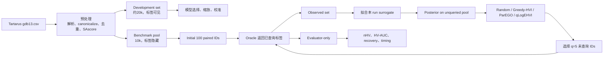

# Sample-Efficient Multi-Objective Molecular Discovery

项目总览与执行计划 · 启动版 v0.1 · 2026-09-28
类型：有限候选池、双目标、离线 Oracle 的分子主动搜索 benchmark

## 1. 一句话说明

从一个固定的有机发光分子候选池中，在只能查询少量分子真实性质的条件下，比较 Random、Greedy-HVI、ParEGO 和 qLogEHVI 能多快找到高质量 Pareto 分子集合。

研究问题：在相同的 500 次 Oracle 评价预算下，利用 surrogate uncertainty 的多目标 Bayesian optimization，是否能比随机搜索和只看预测均值的方法更快恢复高质量 Pareto front？

结果不要求 qLogEHVI 一定获胜。只要实验公平、无标签泄漏、统计可信且可复现，负结果同样成立。

## 2. 科学问题

### 2.1 搜索空间

- 数据：[Tartarus](https://github.com/the-matter-lab/Tartarus)，任务 Designing Organic Emitters，文件 `datasets/gdb13.csv`（文档记录约 403,947 个 SMILES）；
- 只从清洗后的固定候选池中选分子；不生成新 SMILES，不做连续空间优化后解码。

### 2.2 两个目标

物理方向：min ΔE_ST，max f_osc。内部统一最大化：

- y1 = −ΔE_ST（singlet–triplet gap，越小越好）
- y2 = f_osc（oscillator strength，越大越好）

两者可能存在 trade-off，输出是一组 Pareto-optimal molecules。

### 2.3 可行性约束

进入候选池前必须：能被 RDKit 解析和 sanitize；有稳定且唯一的 canonical SMILES；两个目标值有限有效；能计算 SAscore；主分析满足 SAscore ≤ 4.5。

SAscore 是约束和诊断变量，不是第三个目标。

## 3. Benchmark 核心设定

| 项目 | 决策 |
|---|---|
| 问题类型 | finite-pool bi-objective active search |
| Oracle | 对预计算标签的受控、确定性 lookup |
| Development set | 约 20,000 个分子，seed=7，标签可见 |
| Benchmark pool | 10,000 个分子，seed=42，未查询标签隐藏 |
| 表示 | Morgan fingerprint，radius=2，nBits=2048 |
| 目标 | maximize (−ΔE_ST, f_osc) |
| 约束 | SAscore ≤ 4.5 |
| Initial / 后续 / 总预算 | 100 / 400 / 500 |
| Batch size | q=5，80 轮 |
| 方法 | Random、Greedy-HVI、ParEGO、qLogEHVI |
| Paired run seeds | 0–9，至少 5 个，目标 10 个 |
| 主曲线 | Normalized HV vs cumulative Oracle evaluations |
| 主标量指标 | Normalized HV-AUC，区间 100–500 |
| 统计 | paired differences、95% CI、effect size |

一次查询 5 个分子记为 5 次 evaluations。

## 4. 四种方法

- **Random**：无放回随机选择。不学习结构–性质关系时，500 次能找到多好的 Pareto set？
- **Greedy-HVI**：只用 posterior mean 计算 deterministic HVI。只相信最佳预测、不主动探索时表现如何？
- **ParEGO / qLogNParEGO**：随机权重 + augmented Chebyshev scalarization + uncertainty-aware EI。通过变换权重能否有效覆盖不同 trade-off？
- **qLogEHVI**：从 posterior 采样估计 batch 的 expected HVI（log-domain）。直接利用多目标 uncertainty 能否更高效扩大 HV？

Greedy-HVI vs qLogEHVI 是关键对比：相同 surrogate，前者不用 uncertainty，后者用。

## 5. 工作流与权限边界



- optimizer 可见：候选 ID、结构特征、已查询标签；不可见：未查询 benchmark 标签；
- evaluator 可见完整 pool 真值，但结果不能反馈给 acquisition；
- development 数据可用于模型选择和缩放，但预训练权重不能带入正式 run。

## 6. 10 周路线

| 阶段 | 主要工作 | 完成门槛 |
|---|---|---|
| M0 | 建仓库、冻结协议、固定环境和数据身份 | 协议每项有唯一答案或公式 |
| Week 1 | 清洗、canonicalize、SAscore、split、fingerprint、EDA | 同配置生成完全相同的 pool |
| Week 2 | Mean/RF/ExtraTrees 监督基线 | 解释全局误差与 Pareto-region 误差 |
| Week 3 | Ensemble/GP uncertainty 与 calibration | surrogate 选择不只依赖 RMSE |
| Week 4 | Pareto、HV、evaluator | 手算案例单元测试全部通过 |
| Week 5 | Single-objective ask–query–tell | 无重复查询和标签泄漏 |
| Week 6–7 | Greedy-HVI、ParEGO、qLogEHVI | 四种方法共用 runner 和协议 |
| Week 8 | 5–10 paired seeds | 结果可从日志一键重建 |
| Week 9 | 额外 pool、消融、失败分析 | 结论不由单一 seed/pool 驱动 |
| Week 10 | README、复现命令、摘要 | 新用户能运行 smoke benchmark |

Tanimoto GP、GNN、noisy Oracle、multi-fidelity 等扩展，只在核心 benchmark 完成后逐个进行。

## 7. 最终交付物

- **数据**：来源与 SHA-256、清洗报告、ID mapping、split IDs、fingerprints、EDA 图；
- **模型**：Mean/RF/ExtraTrees 对比、random vs scaffold split、global vs Pareto-region 误差、calibration、frozen surrogate；
- **优化**：隔离 Oracle、统一 runner、四种方法、q=1 smoke、q=5 正式运行；
- **评价**：Pareto/HV 单元测试、nHV 曲线、HV-AUC、HV regret、Pareto recovery、多样性、运行时间、paired statistics；
- **展示（最多四张图）**：nHV vs Oracle calls；paired HV-AUC；true vs discovered Pareto；calibration vs downstream performance。

## 8. Project Start Gate（当前优先级）

Gate 通过前：不训练 surrogate，不写 qLogEHVI，不跑正式 benchmark，不做结果导向的 EDA。

输出文件：

```text
README.md
.gitignore
environment.yml
environment.lock.yml
configs/benchmark.yaml
docs/benchmark_spec.md        # 含流程图与验收 checklist
data/raw/README.md
data/raw/manifest.yaml
```

`benchmark_spec.md` 必须冻结十项：

1. 数据来源、版本和 SHA-256；
2. 两个目标列、单位和方向；
3. SAscore ≤ 4.5 约束；
4. development 与 benchmark 的隔离方式；
5. development seed、pool seed、paired run seeds；
6. initial size、总预算、q、轮数；
7. 四种方法的定义；
8. objective scaling 公式和 fit source；
9. acquisition / evaluation reference point 规则；
10. 主指标、次指标、统计汇总方法。

可暂为 provisional，但必须有唯一计算规则和填写时机：清洗后行数、development mean/std、evaluation reference 数值、Week 3 surrogate 最终选择、qLogEHVI MC samples 与 chunk size。

`configs/benchmark.yaml` 只存机器可读规则；科学理由写在 spec 中；不在代码和 YAML 中维护两套默认值。

`data/raw/manifest.yaml` 至少记录：source_repository、source_commit、source_path、downloaded_at、sha256、file_size_bytes、row_count_raw、column_names_raw、license_source、notes。

需核验：不是 Git LFS pointer 或错误页；目标列真实名称；缺失值表示；原始文件只读。

禁止：按目标值挑选 pool；用完整 benchmark 标签决定 scaling；将原始大文件提交 Git。

### Gate 验收

- [x] Git repository 已初始化
- [x] .gitignore 排除 raw data、processed、runs、权重、缓存
- [x] 独立 Python 3.11 环境（conda `mmo`）
- [x] RDKit/PyTorch/BoTorch import smoke test 通过（`scripts/smoke_env.py`）
- [x] 依赖版本已锁定（`environment.lock.yml`）
- [x] benchmark_spec 十项已填写
- [x] benchmark.yaml 与 spec 数值一致
- [x] 流程图显示 optimizer / oracle / evaluator 权限边界
- [x] gdb13.csv 的 source commit、SHA-256、大小、行数、header 已记录
- [x] 原始数据未被修改（chmod 444）

Gate 后第一个编码任务：只读的 raw-data inspection 脚本，验证 schema、有限数值、SMILES 解析率和重复情况，输出机器可读质量报告；不修改原文件，不生成正式 split。

## 9. 成功标准

1. 未查询 benchmark 标签没有泄漏；
2. 四种方法使用相同 pool、initial sets、预算和评价规则；
3. uncertainty 经过实际校准；
4. Pareto/HV 计算经过手算单元测试；
5. 结论来自多个 paired seeds 和置信区间；
6. 全部结果能从 run logs 重建；
7. 正负结果都有可信解释；
8. README 明确这是 Tartarus-derived、offline-oracle、finite-pool benchmark；
9. 不把结论夸大为湿实验或器件性能证明。
